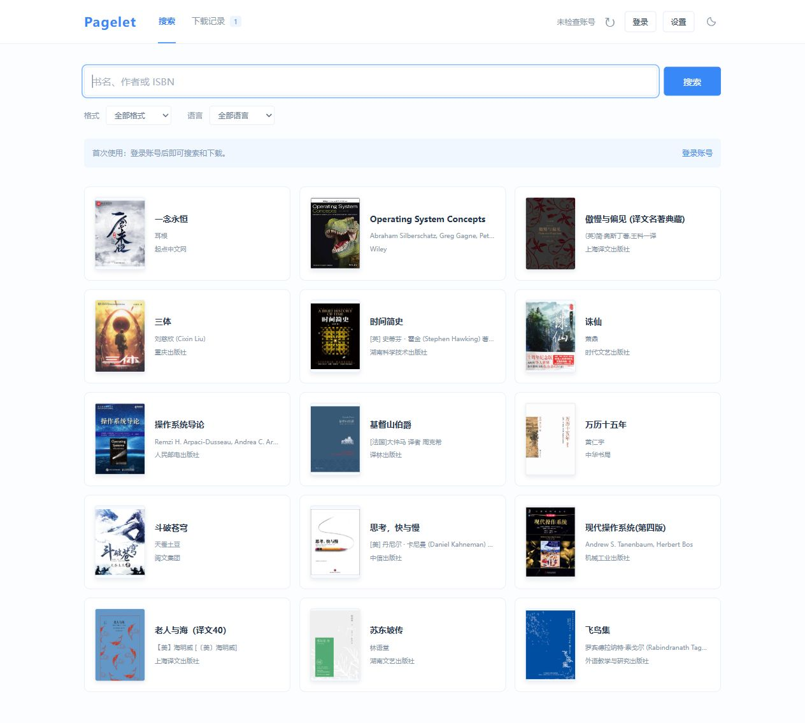
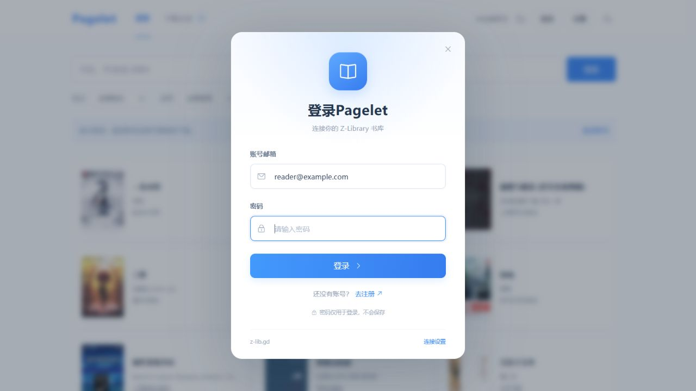
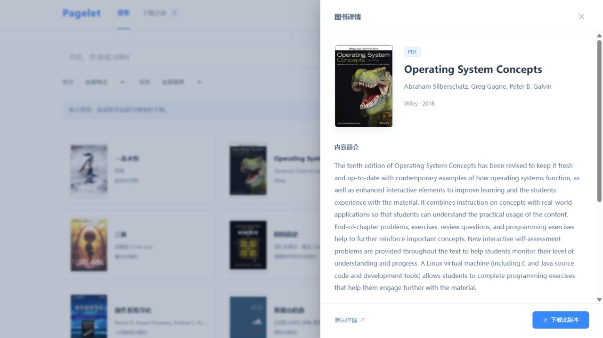
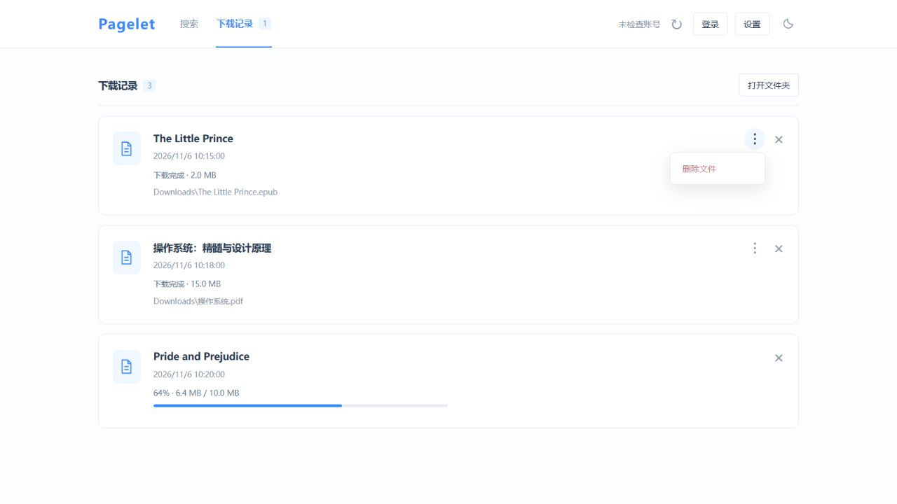
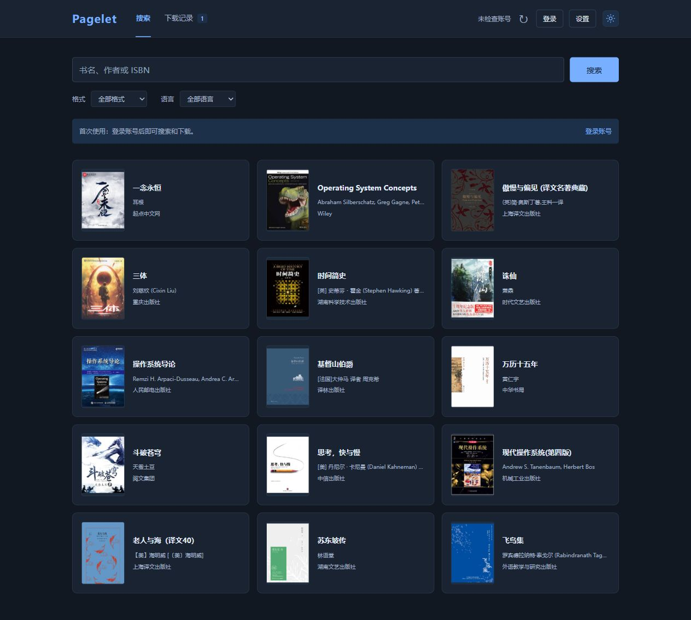

<div align="center">


# Pagelet

**简单一点，找到想读的书。**

一个在本机运行的找书工具。蓝白界面、封面与简介、下载管理，解压后双击即可使用。

[下载 Windows 版](https://github.com/beemines/pagelet/releases/latest) · [使用方法](#使用方法) · [常见问题](#常见问题)


[](LICENSE)



</div>

## 下载安装

**[下载 Pagelet v0.0.1 · Windows x64 ZIP](https://github.com/beemines/pagelet/releases/download/v0.0.1/Pagelet-v0.0.1-windows-x64.zip)**

解压整个 ZIP 到自己的文件夹，双击 **`Pagelet.exe`**。浏览器会自动打开 Pagelet。

无需安装 Python、Node.js 或额外下载 zlib，也不需要输入命令。请先解压，再运行；保留程序旁的 `_internal` 和 `bin` 文件夹。GitHub 的 **Source code** 是开发源码，普通使用请选择上面的 Windows ZIP。

支持 Windows 10 / 11 64 位。需要可用网络和自己的 Z-Library 账号；软件本身不提供账号、下载额度或图书文件。

## 使用方法

### 1. 登录账号

点击右上角 **登录**，输入自己的账号邮箱和密码。没有账号，可点弹窗里的 **去注册**，前往当前设置的书库网站注册。



程序已预置访问域名。若连接失败，打开 **设置**，检测或更换为你能够访问的 Z-Library HTTPS 域名；需要代理时填入自己的代理地址。注册和图书服务的可用性取决于该网站及网络。

### 2. 搜索与查看简介

输入书名、作者或 ISBN，按回车或点击 **搜索**。可筛选格式和语言；全部格式下，当前页的 PDF 会优先显示。查询期间会显示等待提示。

点击图书卡片查看封面、作者、出版社、格式、页数、ISBN 和简介。内容是否齐全取决于书库提供的数据；简介用于判断版本，暂不提供正文试读。主页图书是内置展示书架，不代表实时可下载状态。



### 3. 下载与管理

在详情或搜索结果中点击 **下载**，到 **下载记录** 查看进度。默认保存到程序旁的 `Downloads` 文件夹，可在设置中更改。



- 下载中显示进度条，点击右侧 **×** 可终止任务。
- 下载结束后收起进度条；此时 **×** 仅移除记录，保留文件。
- 点击 **⋮ → 删除文件**，确认后将文件移入 Windows 回收站。无法使用回收站时会中止删除。
- 点击 **打开文件夹** 可查看下载结果。

### 4. 按喜好使用

右上角的月亮 / 太阳按钮切换浅色与深色模式。主页简介、书籍详情和短时间内的搜索结果会缓存在当前浏览器中，减少重复查询；账号信息和下载记录不进入这份图书缓存。



## 常见问题

**这是不是独立书库？需要另装 zlib-cli 吗？**  
Pagelet 是 [heartleo/zlib](https://github.com/heartleo/zlib) 的本地图形界面，搜索、登录、详情和下载依赖随包附带的 zlib v0.0.12。Windows 发布包已经带齐运行组件，无需另装 CLI。

**为什么双击后打开的是浏览器？**  
Pagelet 使用本地网页作为界面，服务仅监听 `127.0.0.1`，不会作为公网网站发布。默认端口为 8877，占用时会尝试附近端口。重复双击会复用本目录已启动的服务。

**关闭网页就退出了吗？**  
关闭标签页后后台服务仍可继续下载。完全退出请到 **设置 → 退出本地服务**。下次双击 `Pagelet.exe` 即可重新打开。

**我的数据存在哪里？怎么更新？**  
设置和下载历史在程序旁 `data` 文件夹；默认图书在 `Downloads`。登录会话由原版 zlib 保存在当前 Windows 用户的 `.config/zlib/session.json`，不要分享这个文件。浏览器还会保存主题和图书缓存。

更新时先退出服务，将新版解压到新文件夹，再按需迁移 `data` 和 `Downloads`。旧设置里的下载目录是绝对路径，移动软件后请在设置中确认。发布包不包含开发者账号、个人设置或下载文件。

**没有封面、简介，或者登录 / 搜索失败？**  
先检查设置中的域名和代理，再确认同一域名的网页端能登录。封面和简介可能缺失；下载额度、验证码、账号限制及访问规则由书库决定。遇到问题可附上版本号和脱敏后的错误提示到 [Issues](https://github.com/beemines/pagelet/issues)，不要上传密码或会话文件。

## 从源码运行 / 构建

普通使用直接下载 ZIP。开发环境为 Windows x64、Python 3.13、Node.js 22.12 或更新的兼容版本。

```powershell
python -m pip install -r requirements-build.txt                     # 打包工具
python -m pip install -r requirements-windows.txt --target vendor    # Windows 原生组件
python scripts/build_windows.py                                    # 构建前端、校验并捆绑原版 CLI、生成 ZIP
```

构建结果位于 `dist/`。构建脚本锁定上游版本并验证 SHA-256，运行时数据不进入 ZIP。`.github/workflows/windows-build.yml` 提供可手动触发的 Windows 构建。

开发时可在项目的上一级解压上游发布包为 `zlib-windows-v0.0.12/zlib.exe`，然后运行 `python launcher.py`。前端组件源码在 `login-ui/`，修改后执行 `npm ci` 和 `npm run build`。测试命令：

```powershell
python -m unittest discover -v       # 服务、登录、下载及路径测试，使用模拟数据
node --test test_book_cache.cjs      # 浏览器缓存测试
```

## 致谢与许可

Pagelet 代码使用 [MIT License](LICENSE)。感谢 [heartleo/zlib](https://github.com/heartleo/zlib)、Vue、Element Plus、PyInstaller、pywinpty、pywin32 和 Send2Trash。第三方许可证随发布包提供，详见 [THIRD_PARTY_NOTICES.md](THIRD_PARTY_NOTICES.md)。

Pagelet 与 Z-Library 无隶属关系。书籍封面、书名和简介用于展示与识别，权利归各自权利人，不包含在 Pagelet 的 MIT 授权中。请仅访问和下载你有权使用的内容。
